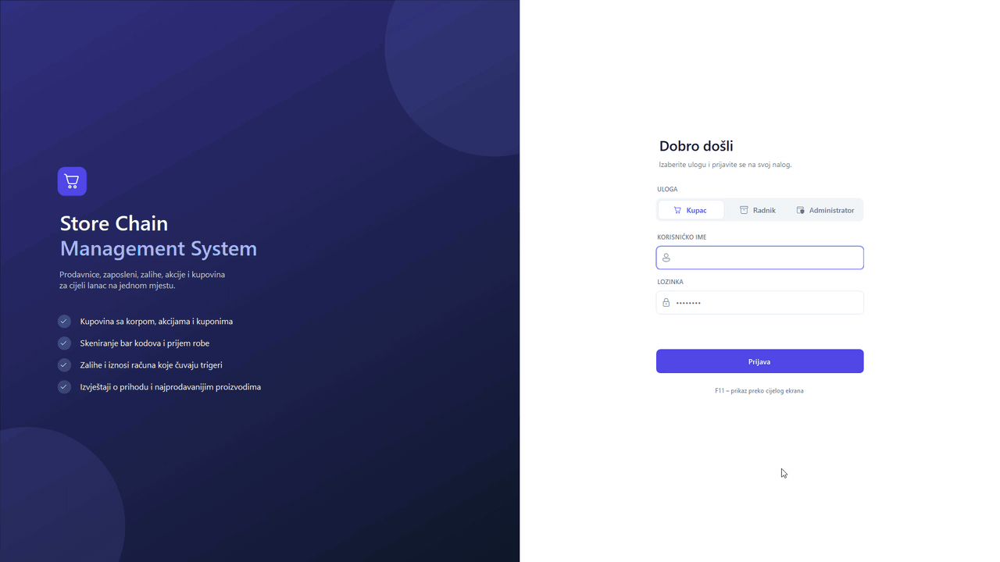
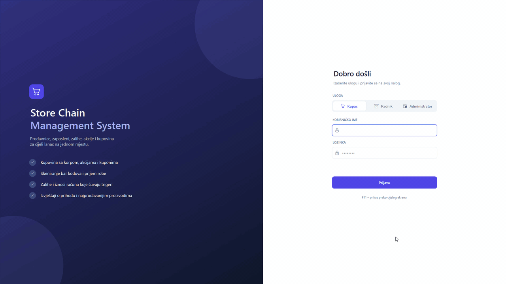
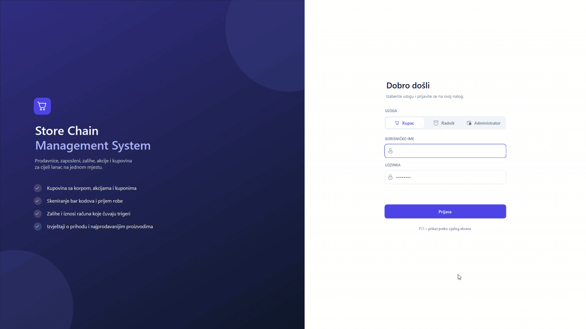
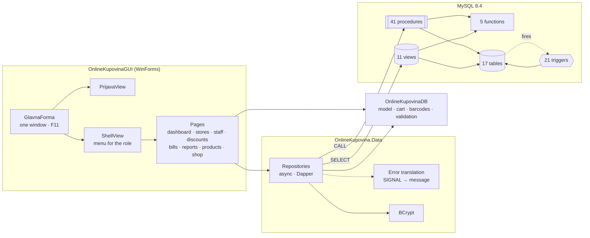
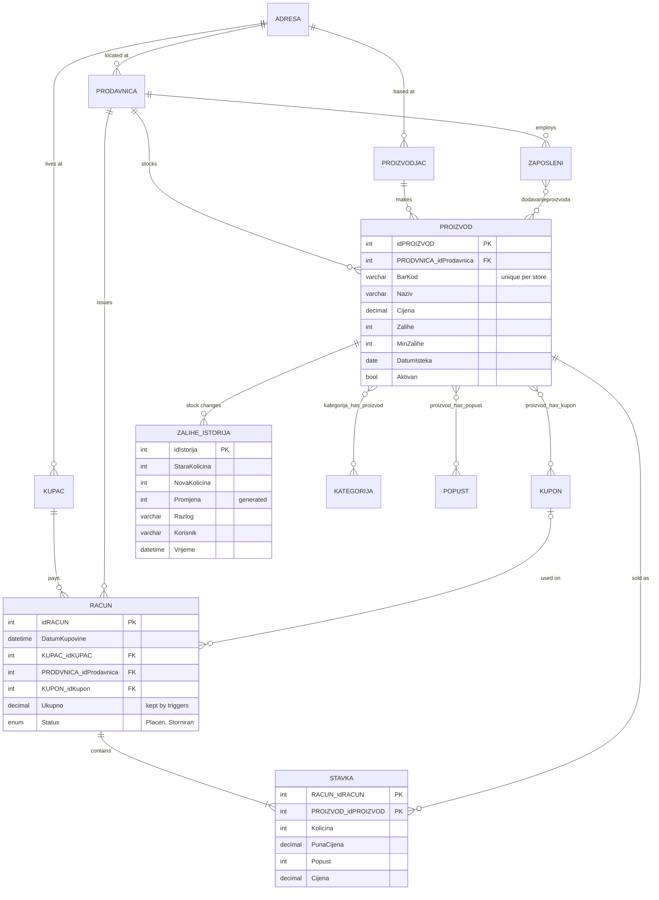
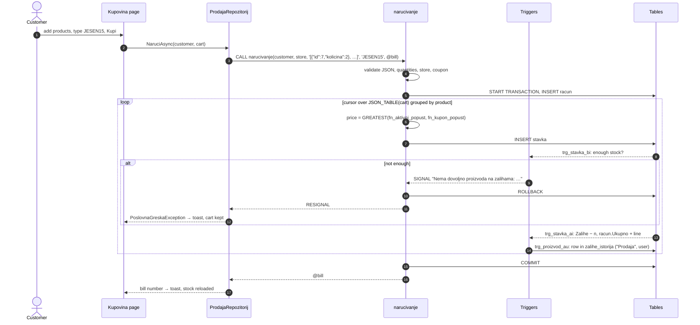
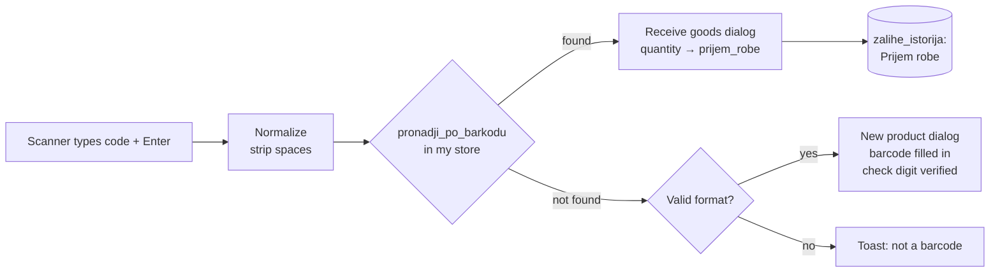

<div align="center">

# 🛒 Store Chain Management System

[](https://github.com/pero-grubac/Store-Chain-Management-System/actions/workflows/ci.yml)


**A Windows desktop application for running a retail chain: stores, staff, stock, discounts, shopping and reports, built around a MySQL database that enforces the business rules itself.**


</div>

---

## 📌 Project Overview

**Store Chain Management System** is a WinForms application for a chain of shops, started as a databases course project. Everyone signs in on the same screen, picks a role, and gets a workspace built for that role.

The database is the heart of the system: **17 tables, 41 stored procedures, 21 triggers, 5 functions and 11 views**. Prices with discounts, stock levels, bill totals, cancellations and the stock audit log are all computed and guarded in MySQL, so they stay correct no matter which client writes to the database.

| Role | Signs in as | What they do |
|------|-------------|--------------|
| 🛡️ **Administrator** | `Administrator` | Dashboard, stores, employees, customers, discounts and coupons, all bills (with cancellation), reports, other administrators |
| 🧑‍💼 **Employee** | `Radnik` | Products of their own store with barcode scanning, receiving goods, low-stock list with stock history, manufacturers |
| 🛍️ **Customer** | `Kupac` | Shopping in any store with a cart and coupons, own bills with every line and the savings |

Every role can change its own password under **Podešavanja**.

---

## 🎬 Use Cases

One everyday task per role, recorded in full screen on the demo data. The clips follow each other: the employee restocks, the customer buys, the administrator sees both.

### 🧑‍💼 Employee: restock and add a new product

The employee opens **Zalihe** to see what is running low, scans the yoghurt that is below its minimum and receives 48 pieces. Then a barcode that is not in the catalogue is scanned, so the new-product form opens with the code already filled in; name, manufacturer, price and starting stock are entered and saved. **Zalihe** now shows both changes in the stock history, with the reason and the employee.



### 🛍️ Customer: shop with a coupon

The customer adds chocolate on discount with a double click, searches for *plazma* and adds two packs, then scans a juice barcode straight into the cart. The `JESEN15` coupon lowers the prices of the products it covers, the cart shows the savings, and **Kupi** creates the bill. **Moji računi** shows the new bill with the full price, discount and final price of every line.



### 🛡️ Administrator: watch the business, run a promotion, cancel a bill

The administrator checks the dashboard (revenue per day and per store, best sellers, low stock), starts a 25 % promotion on coffee, opens the newest bill and cancels it. In **Izvještaji → Istorija zaliha** the cancellation has put the goods back on the shelf, next to the customer's sale and the employee's restock, all written by triggers.



---

## ✨ Features

- 📊 **Dashboard**: revenue, bill count, average basket and low-stock count for the last 7, 30 or 90 days; revenue per day and per store as charts; best sellers and products to reorder
- 🏬 **Stores, employees, customers, administrators**: full create, edit and delete, each with its address; passwords set or reset by the administrator
- 🏷️ **Discounts and coupons**: a discount applies to a product for a period; a coupon code is typed in the cart and can cover several products; when both apply, the bigger one wins
- 📷 **Barcode scanning**: a scanner works as a keyboard, so the employee just scans. A known code opens *receive goods*, an unknown one opens *new product* with the code filled in. EAN-8, UPC-A, EAN-13 and GTIN-14 are checked by their check digit, and goods without a barcode get an internal EAN-13
- 📦 **Stock that cannot drift**: a sale lowers stock, a cancelled bill puts it back, receiving adds to it, and every change lands in a stock history with the reason and the user
- 🛒 **Shopping**: pick a store, search or scan, fill a cart, apply a coupon, buy. The cart shows the same prices the database will charge, and an order that cannot be filled changes nothing
- 🧾 **Bills**: every bill with its lines, full price, discount and final price; the administrator can cancel a bill
- 📈 **Reports**: revenue per store and per day, best sellers ranked, and the full stock history, each exportable to CSV for Excel
- ✅ **Validation and friendly errors**: every form checks all fields at once and keeps what you typed; database errors come back as plain sentences, not exceptions
- ⚡ **Responsive**: every database call is asynchronous, so the window never freezes
- 🖥️ **Modern UI**: one window, a sidebar for the role, cards, charts, toasts; starts maximized, **F11** for full screen

---

## 🗄️ Database

All scripts are in [`database/`](database/) and run in order:

| Script | Contains |
|--------|----------|
| [`01-schema.sql`](database/01-schema.sql) | 17 tables with foreign keys, unique keys, `CHECK` constraints, `DECIMAL` money, an `ENUM` bill status and a generated column |
| [`02-functions.sql`](database/02-functions.sql) | `fn_aktivni_popust`, `fn_cijena_sa_popustom`, `fn_kupon_popust`, `fn_status_zaliha`, `fn_status_perioda` |
| [`03-procedures.sql`](database/03-procedures.sql) | 41 procedures: every write that touches more than one table, plus the reports |
| [`04-triggers.sql`](database/04-triggers.sql) | 21 triggers for validation, stock, bill totals, cancellation and the audit log |
| [`05-views.sql`](database/05-views.sql) | 11 views the application reads from |
| [`06-seed.sql`](database/06-seed.sql) | Demo data: 4 stores, 56 products, 18 accounts and 160 bills over the last 90 days |

### Triggers

| Table | Trigger | What it does |
|-------|---------|--------------|
| `proizvod` | `BEFORE INSERT / UPDATE` | Trims the barcode and name, rejects bad barcodes, negative prices or stock, and an expiry date in the past |
| `proizvod` | `AFTER INSERT / UPDATE` | Writes every stock change to `zalihe_istorija` with the reason (`@razlog_zaliha`) and user (`@korisnik`) |
| `stavka` | `BEFORE INSERT / UPDATE` | Quantity above zero, product from the bill's store, enough stock (names the product in the error), no changes to a cancelled bill |
| `stavka` | `AFTER INSERT / UPDATE / DELETE` | Lowers or returns stock and keeps `racun.Ukupno` equal to the sum of its lines |
| `racun` | `BEFORE UPDATE` | A cancelled bill cannot be reopened; customer and store never change |
| `racun` | `AFTER UPDATE` | Cancelling a bill returns all of its goods to stock |
| `popust`, `kupon` | `BEFORE INSERT / UPDATE` | 1–90 %, end not before start, coupon code upper-cased and checked |
| `administrator`, `zaposleni`, `kupac` | `BEFORE INSERT / UPDATE` | Lower-cased email and username, both validated, and the password must be a BCrypt hash, so plain text cannot be stored even by hand |

### Selected procedures

| Procedure | Shows |
|-----------|-------|
| `narucivanje` | Order from a JSON cart: `JSON_TABLE`, a **cursor**, prices and discounts computed in SQL, `START TRANSACTION` / `ROLLBACK` with `RESIGNAL`, the new bill number as an `OUT` parameter |
| `storniraj_racun` | Cancels a bill; the trigger on `racun` returns the stock |
| `prijem_robe` | Receiving goods with the reason and user passed to the audit trigger |
| `promijeni_lozinku` | Dynamic SQL with `PREPARE` / `EXECUTE`, table name from a whitelist, values as parameters |
| `dodaj_prodavnicu`, `registruj_kupca`, `registruj_proizvodjaca` | Address and record in one transaction, procedures calling procedures |
| `obrisi_proizvod` | Deletes an unsold product, deactivates one that appears on bills |
| `izvjestaj_prihod_po_danima` | Recursive CTE, so days without sales still get a row |
| `izvjestaj_najprodavaniji` | Window function `RANK()` |
| `izvjestaj_kpi`, `izvjestaj_prihod_po_prodavnici`, `istorija_zaliha`, `pregled_racuna` | Reports with date ranges, excluding cancelled bills |

The original procedures (`dodaj_*`, `get_proizvod_by_prodavnica`, `kreiraj_kupon`, `narucivanje`, `obrisi_*`, `update_proizvod`, `detalji_racuna`) are all still there, extended.

---

## 🛠️ Tech Stack

| Technology | Usage |
|------------|-------|
| .NET 10 + C# 14 | Application, domain model, data access |
| Windows Forms | Desktop UI, drawn with custom controls (no third-party UI library) |
| MySQL 8.4 | Data, constraints, procedures, triggers, functions, views |
| MySqlConnector + Dapper | Asynchronous data access with mapping to the domain classes |
| BCrypt.Net-Next | Password hashing |
| Docker Compose | Local database with schema and demo data |
| xUnit v3 | Unit, UI and integration tests |
| Testcontainers | A real MySQL for every integration test run |
| GitHub Actions | CI (build, unit tests, database tests) and releases |

---

## 📁 Repository Structure

```
Store-Chain-Management-System/
├── OnlineKupovinaGUI/            WinForms application
│   ├── Ui/                       theme, buttons, cards, inputs, tables, charts, dialogs, toasts
│   ├── Views/                    main window, sign-in, shell with the role menu
│   │   └── Stranice/             one page per menu item
│   ├── DBUtil.cs                 reads the connection string from configuration
│   └── appsettings.json          connection string for the local Docker database
├── OnlineKupovina.Data/          data access: repositories over procedures and views, error translation, BCrypt
├── OnlineKupovinaDB/             domain model: products, bills, cart, barcodes, prices, validation
├── database/                     SQL scripts, run in order by Docker and by the tests
├── tests/
│   ├── OnlineKupovina.Tests/     domain tests + MySQL integration tests (Testcontainers)
│   └── OnlineKupovinaGUI.Tests/  pages, fields, CSV export and configuration (Windows)
├── Model/                        MySQL Workbench model and ER diagram
├── docker-compose.yml            local MySQL on 127.0.0.1:13306
├── global.json                   .NET SDK version
└── .github/workflows/ci.yml      CI/CD
```

---

## 🚀 Setup & Run

### Prerequisites
- Windows 10 or 11
- [.NET 10 SDK](https://dotnet.microsoft.com/download/dotnet/10.0)
- [Docker Desktop](https://www.docker.com/products/docker-desktop/) (for the database and the integration tests)
- Visual Studio 2026 or Rider (optional)

### 1. Clone the repository
```bash
git clone https://github.com/pero-grubac/Store-Chain-Management-System.git
cd Store-Chain-Management-System
```

### 2. Start the database
```bash
docker compose up -d
```

On the first start MySQL runs the six scripts from [`database/`](database/). It listens on `127.0.0.1:13306`, on this machine only. The demo bills are dated relative to today, so the dashboard always has data.

### 3. Run the application
```bash
dotnet run --project OnlineKupovinaGUI
```

Or open `OnlineKupovina.sln` and start **OnlineKupovinaGUI**. The window opens maximized; **F11** switches to full screen (**Esc** leaves it), and `--fullscreen` starts in full screen.

### 🔑 Demo accounts

| Role | Username | Password |
|------|----------|----------|
| Administrator | `admin` | `Admin123!` |
| Radnik (employee, store *Centar Banja Luka*) | `radnik` | `Radnik123!` |
| Kupac (customer) | `kupac` | `Kupac123!` |

More employees (`jelena`, `emir`, `ivana`, `milica`, `dario`, `sanja`, `petra`) and customers (`sara`, `nikola`, `lejla`, `marko`, `ana`, `dejan`, `tea`) use the same password as their role. Coupon codes to try: `JESEN15`, `KAFA10` (and the expired `LJETO30`).

### ⚙️ Configuration

The connection string is read in this order, first match wins:

| Source | When to use it |
|--------|----------------|
| `PRODAVNICA_CONNECTION_STRING` environment variable | Another server, CI, a shared machine |
| `OnlineKupovinaGUI/appsettings.Local.json` (git-ignored) | Your own local database with your own password |
| `OnlineKupovinaGUI/appsettings.json` | The Docker database from `docker-compose.yml` |

```json
{
  "ConnectionStrings": {
    "Prodavnica": "Server=127.0.0.1;Port=3306;Database=prodavnica;User Id=me;Password=..."
  }
}
```

> Using an existing MySQL 8 instead of Docker: create a database named `prodavnica`, run the six scripts from `database/` in order as a user allowed to create functions and triggers (or with `log_bin_trust_function_creators=1`), then point `appsettings.Local.json` at it.

### Reset the demo data
```bash
docker compose down -v
docker compose up -d
```

---

## 🧪 Tests

```bash
# everything (integration tests need Docker running)
dotnet test

# only the fast tests, no Docker
dotnet test --filter "Category!=Integration"

# only the database tests
dotnet test tests/OnlineKupovina.Tests --filter "Category=Integration"
```

| Suite | Tests | What it covers |
|-------|------:|----------------|
| Domain | 43 | Cart (merging, stock limit, one store, coupons, bigger discount wins, JSON for the procedure), prices rounded exactly like MySQL, barcode check digits and internal EAN-13, validation of every entity |
| Passwords and errors | 8 | BCrypt hashing with a fresh salt, malformed hashes, validation messages collected into one |
| SQL scripts | 6 | Order, no `DEFINER`, lower-case table names, 21 triggers, valid demo password hashes and barcodes |
| UI | 19 | Every page builds, the menu depends on the role, full-screen toggle, dialog fields, CSV export, configuration order |
| Schema | 38 | All tables, views and functions exist, all 41 procedures, money as `DECIMAL`, barcode unique per store, seeded bill totals match their lines |
| Functions | 6 | Biggest active discount, discounted price, coupon only for linked products and valid dates, stock and period status |
| Triggers | 15 | Product validation, stock history with reason and user, bill lines keep stock and totals in sync, cancellation returns stock and cannot be undone, plain-text passwords rejected, discount and coupon rules |
| Orders | 13 | Bill, lines and stock in one step; database price equals cart price with discount and coupon; invalid or expired coupon; **full rollback** on missing stock; wrong store; bad JSON; duplicate lines merged |
| Repositories | 24 | Sign-in for every role, password change rules, stores, employees, customers, administrators, products, manufacturers, discounts and coupons, friendly messages for duplicates and protected deletes |
| Reports | 5 | KPIs, revenue per store and per day, ranking, cancelled bills left out |

Integration tests start their own `mysql:8.4` container through Testcontainers and load the same `database/` scripts as Docker Compose, so they test exactly what the application runs on. Without Docker they are skipped locally and fail in CI.

---

## ⚙️ CI/CD

[`ci.yml`](.github/workflows/ci.yml) runs on pushes and pull requests to `main`, **but only when something that affects the build changes**: C# code, project files, resources, `database/`, `docker-compose.yml`, `global.json` or the workflow itself. README edits, images, the Word document and the license do not start a run. It can also be started by hand.

| Job | Runner | Steps |
|-----|--------|-------|
| **Build & unit tests** | `windows-latest` | Restore, Release build of the whole solution, unit and UI tests, test report |
| **Database integration tests** | `ubuntu-latest` | Real MySQL 8.4 through Testcontainers, all procedure, trigger, view and repository tests |
| **Release** | `windows-latest` | Only for tags `v*`, after both jobs pass: self-contained single-file `win-x64` build, zipped with `database/` and `docker-compose.yml`, attached to a GitHub release |

A newer push to the same branch cancels the run still in progress.

```bash
git tag v2.0.0
git push origin v2.0.0
```

---

## 🏗️ Architecture



Pages never contain SQL. They validate input with the domain model, call a repository, and show either the result or the message from the database. Repositories call procedures for every write and read from views, so the rules live in one place: the database.

### Data model



The original model is in [`Model/Prodavnica.mwb`](Model/Prodavnica.mwb) (MySQL Workbench), with an image in [`Model/Prodavnica.png`](Model/Prodavnica.png).

### Placing an order



### Scanning a barcode (employee)



---

## 🧭 Design Decisions

- **The database guards consistency.** Stock, bill totals, cancellations and the audit log are kept by triggers; an order is one transaction; prices and discounts are computed in SQL. A client can show prices, but it never decides them.
- **Errors are sentences.** Business rules fail with `SIGNAL SQLSTATE '45000'` and a message; the data layer turns those, duplicate keys and foreign-key violations into messages the user can act on.
- **Three layers.** The domain model knows the rules for input, the data layer knows the database, the UI only arranges controls. Pages contain no SQL.
- **Barcodes are text and unique per store.** The same product (same EAN) is sold in every store with its own stock and price, and codes with leading zeros or letters work.
- **Money is `DECIMAL`.** No floating-point totals; the cart rounds exactly like MySQL `ROUND`.
- **Passwords are never stored or compared in plain text.** BCrypt everywhere, and a trigger rejects anything that is not a BCrypt hash.
- **Configuration is not code.** The connection string comes from an environment variable or a git-ignored local file; the committed `appsettings.json` only points at the local Docker database.
- **One set of SQL scripts, tested for real.** Docker Compose, the integration tests and a manual install all use the same scripts, and the tests run them against MySQL 8.4 itself.
- **CI only runs when it matters.** Path filters keep documentation edits from using runner minutes; database tests run on Linux where containers are available, the WinForms build runs on Windows.

---

## 📄 License

[MIT](LICENSE.txt)
